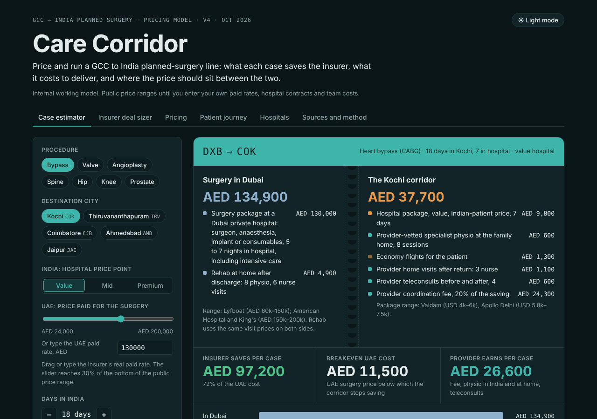
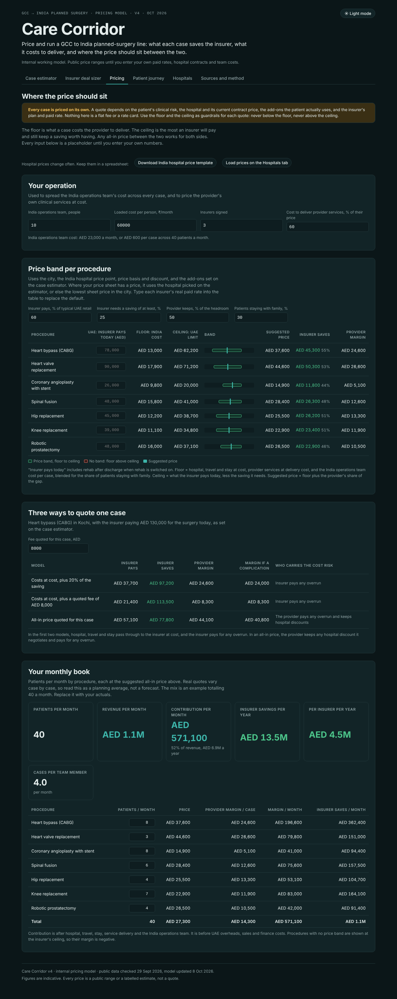
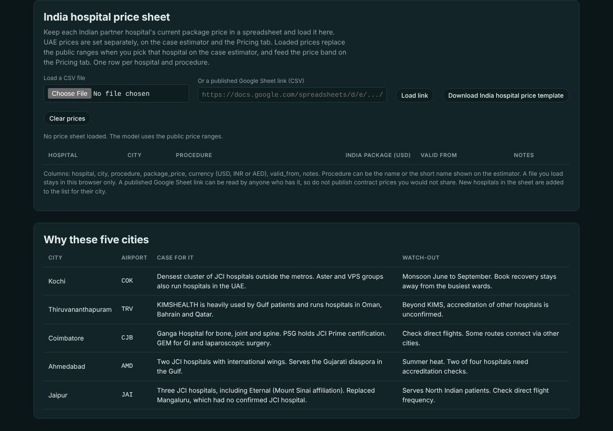

# Care Corridor

**What does a UAE insurer save when planned surgery moves to accredited hospitals in India's tier-2 cities, and where should a care provider price each case?**

Care Corridor is a live model that answers both questions per procedure, per city, per hospital and per insurer. It comes in two views built from one source file: one for the care provider that runs the corridor and prices each case, and one for the insurer deciding whether to buy it.



## Who this is for

- **Care providers and medical travel coordinators** running or planning a GCC-to-India planned-surgery line: saving per case, cost to deliver, and the price band for each quote.
- **Insurers and employers in the GCC** deciding whether a planned-surgery travel benefit is worth offering, and for which procedures. Enter your own paid rates and case counts.
- **UAE residents paying for surgery themselves** who want the full cost of a trip, not just the hospital quote. This is a cost guide, not medical advice.
- **Anyone modelling another medical travel route**, such as the UAE to Turkey or Thailand. Prices, stays, hospitals and cities live in one place, so a new destination is a data change, not a rebuild.

## What it covers

Seven planned procedures, five Indian cities and 21 hospitals:

- Heart bypass (CABG), heart valve replacement, coronary angioplasty with stent
- Spinal fusion, hip replacement, knee replacement, robotic prostatectomy
- Kochi, Thiruvananthapuram, Coimbatore, Ahmedabad and Jaipur

## The two views

| | Provider view (`index.html`) | Insurer view (`insurers.html`) |
|---|---|---|
| Job | How should we price and run each case? | Should we buy it? |
| Headline | Saving, provider earnings and margin per case | Saving per case, saving as a share of spend |
| Fee | Visible: share of the saving, or a fee quoted for the case | Folded into one "managed care" line |
| Extra tabs | Pricing, India hospital price sheet | Why members say yes |

## How the model works

For each case:

```
UAE cost    = what the insurer pays for the surgery + rehab at home after discharge

India cost  = hospital package (range price, or your own hospital price), less any negotiated discount
            + the add-ons this patient actually needs (see below)
            + provider services: physio in India, home visits and teleconsults after return
            + provider fee (share of the saving, or a fee quoted for the case)

Saving      = UAE cost - India cost
```

Defaults are the leanest case: value hospital, Indian-patient price, and the bare minimum of add-ons. A heart bypass in Kochi then costs AED 37,700 against AED 134,900 in Dubai, a saving of AED 97,200.

## What is new in v4

- **Add-ons are switchable.** Companion, serviced apartment, private nurse, meals, transfers, legroom seats, visas, physio in India, digital programme and teleconsults can each be turned off. Presets cover a full package, a patient staying with family near their home town, and the bare minimum. Rehab after discharge switches off on both sides together, so the comparison stays fair.
- **Real paid rates.** The UAE price slider reaches 30% of the bottom of the public price range (AED 24,000 for a bypass), and any paid rate can be typed in.
- **Negotiated discounts.** A slider takes up to 50% off the Indian hospital package for committed volume.
- **Your own hospital prices.** Load a spreadsheet of each Indian hospital's current package price, from a CSV file or a published Google Sheet. Those prices replace the public ranges, and new hospitals in the sheet are added to their city. A template downloads from the page and is also in `data/`.
- **A Pricing tab (provider view).** For every procedure it sets a floor (what a case costs to deliver, including the operations team) and a ceiling (the most an insurer can pay and still keep the saving it needs). It compares three ways to quote a case and rolls up a monthly book of margin and insurer savings. Every case is priced on its own. This is a set of guardrails for each quote, not a rate card.
- **Member reasons that follow the case.** "Why members say yes" changes with the add-ons chosen, and covers waived co-pays, a cash incentive sized case by case, cheaper room upgrades, and being treated close to family.
- **Corrected break-even.** The break-even now lets the fee fall to its floor, so it shows the true UAE price below which the corridor stops saving.
- **Dark mode by default.**



## What it shows

Kochi, at the lean defaults and at a full package (mid-price hospital, international price, all add-ons). UAE figures are public retail ranges.

| Procedure | UAE cost incl. rehab | Saving, lean defaults | Saving, full package |
|---|---|---|---|
| Heart valve replacement | AED 154,900 | AED 109,300 | AED 89,300 |
| Heart bypass | AED 134,900 | AED 97,200 | AED 80,500 |
| Spinal fusion | AED 86,700 | AED 55,600 | AED 39,500 |
| Hip replacement | AED 81,700 | AED 55,100 | AED 38,500 |
| Robotic prostatectomy | AED 81,400 | AED 52,400 | AED 35,900 |
| Knee replacement | AED 72,400 | AED 48,500 | AED 33,600 |
| Coronary angioplasty | AED 43,700 | AED 27,300 | AED 14,800 |

Insurers pay less than retail in the UAE, so real savings will be lower. Type a real paid rate into the estimator, or into the Pricing tab, to see where each procedure stops working.

## Decisions that shaped it

1. **Like-for-like rehab.** Rehab after discharge is counted on both sides at the same visit prices.
2. **Most of the India stay is not in hospital.** A knee case is 21 days in India but only 4 in hospital. The rest is recovery, at an apartment or the family home.
3. **Retail prices on both sides, until you replace them.** UAE figures are package and guide prices, not negotiated insurer rates, which are not public. Indian listings show foreigners paying about 50% more than Indian patients.
4. **Fit to fly sets the stay.** UK guidance suggests about 10 days after heart surgery, about 3 days after a planned angioplasty, and 6 weeks after a joint replacement for short-haul flights.
5. **Heart surgery leads.** It clears to fly fastest and saves the most.
6. **Weight-loss surgery is out.** At current prices it roughly broke even, so angioplasty replaced it.
7. **Pricing is per case.** A quote depends on the patient's risk, the hospital's current contract, the add-ons used and the insurer's plan.

## Reuse the data

The research is published as plain spreadsheets in [`data/`](data), exported from the data in the page. Re-export them if you change the page data:

| File | What is in it |
|---|---|
| `procedures.csv` | UAE and India price ranges, hospital and in-country days, rehab visits and fit-to-fly guidance for 7 procedures |
| `hospitals.csv` | 21 hospitals in 5 cities, with accreditation, whether it was confirmed, procedures and Gulf links |
| `cities.csv` | Airfares from Dubai, why each city was chosen, and what to watch out for |
| `sources.csv` | Every source behind the numbers, with links |
| `india-hospital-prices-template.csv` | One row per hospital and procedure, ready for your own package prices |

Prices and accreditations change. Corrections are welcome as issues, with a source link.

## Load your own hospital prices

1. Download the template from the Hospitals tab, or use `data/india-hospital-prices-template.csv`.
2. Fill in `package_price` and `currency` (USD, INR or AED). Add rows for new hospitals in the same five cities.
3. Load the file on the Hospitals tab. It stays in that browser only.
4. To share prices with a team, publish the sheet from Google Sheets as CSV and paste the link, or set `PRICE_SHEET_URL` in `src/care-corridor.html` and rebuild. Anyone with a published link can read it.



## Limits

- Prices are public ranges and labelled estimates, not hospital quotes.
- No Saudi baselines, transplants or cancer care beyond prostatectomy.
- Provider prices (fee, visits, digital programme), team costs and monthly volumes are placeholders.
- Fit-to-fly timings quote public guidance. The operating surgeon decides.
- Member cash incentives depend on plan wording and local rules.

## Run it

No build tools or dependencies are needed. Open `index.html` or `insurers.html` in a browser.

To change the model, edit the data at the top of the script in `src/care-corridor.html` (`PROCS`, `CITIES`, `HOSP`, `SOURCES`) and run:

```
python3 build.py
```

## Sources

Every figure links to its source in the page's "Sources and method" tab: UAE price guides and hospital packages, Indian hospital and aggregator price listings, UK Civil Aviation Authority fit-to-fly guidance, hospital accreditation records, room rates and Embassy of India population data.

---

Built with Claude Code, September to October 2026. Hospital names are real and taken from public sources. The provider is generic.
